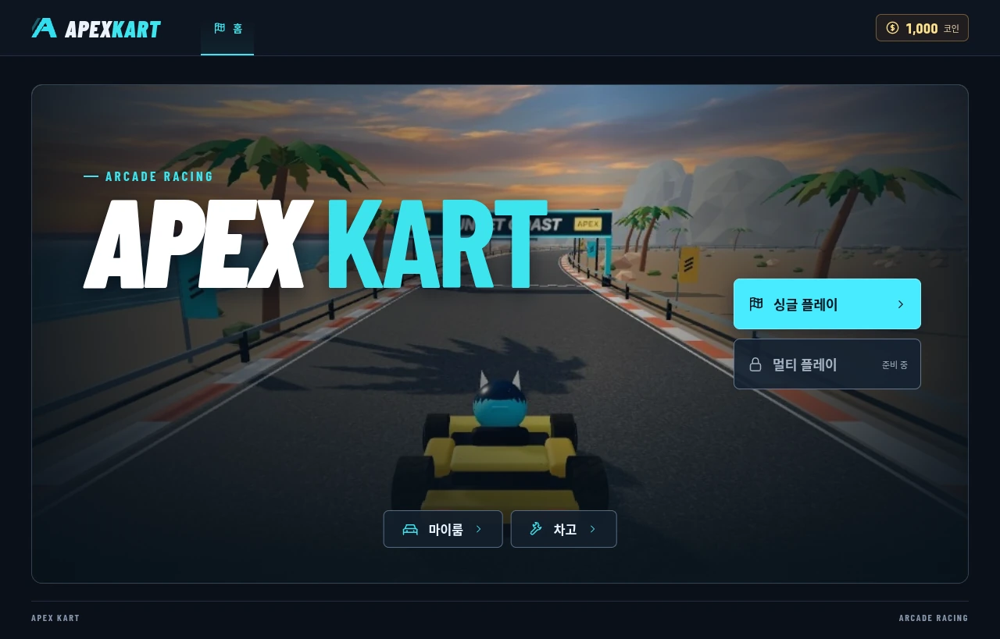
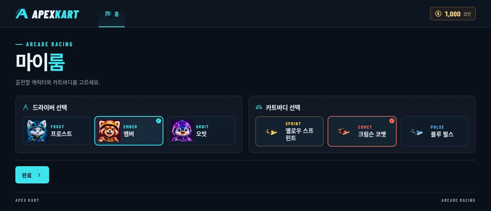
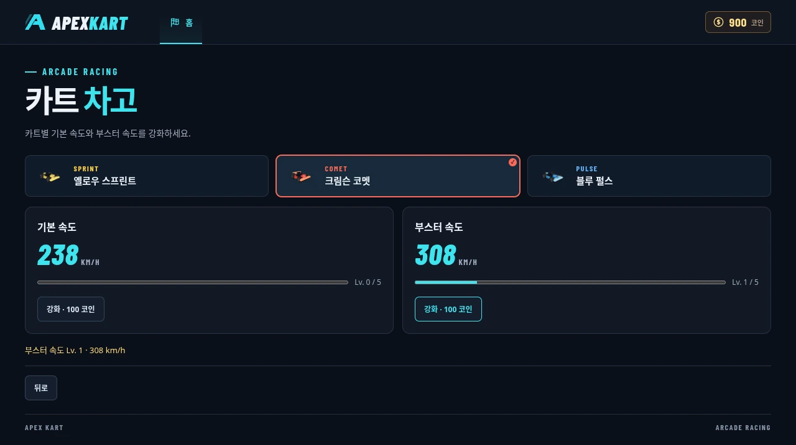
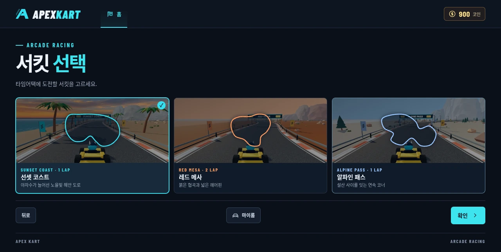
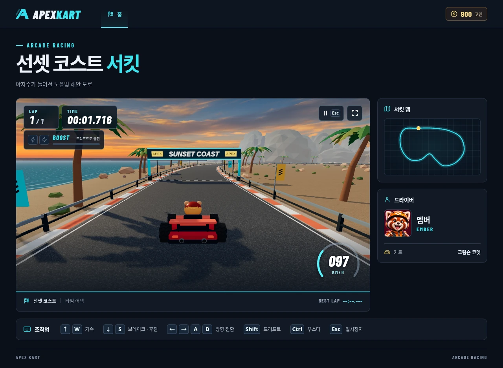
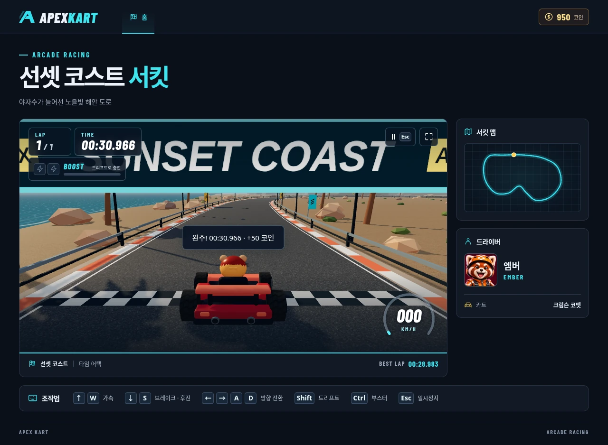
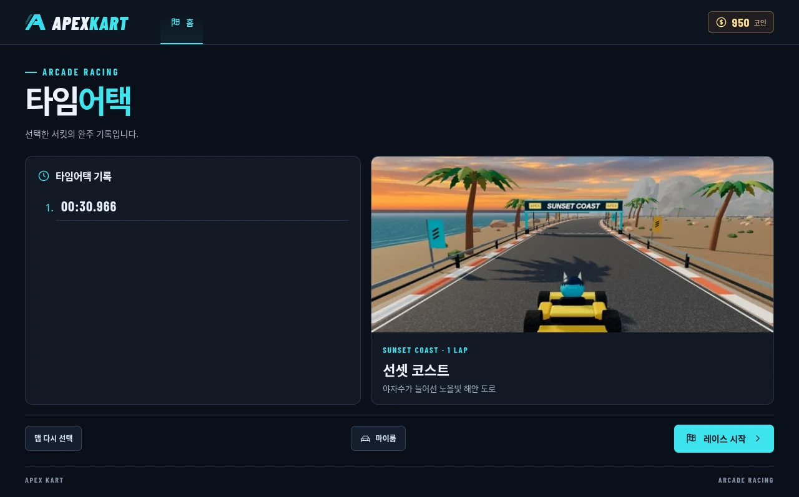
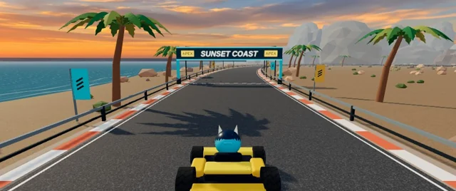
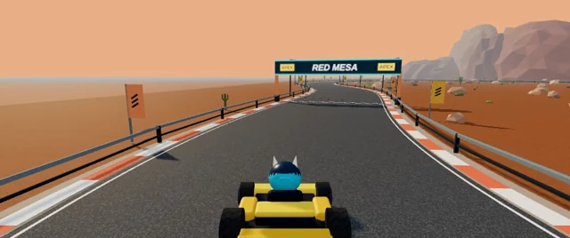
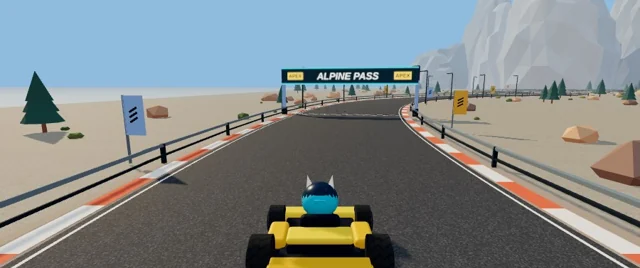

<p align="center">
  
</p>
<h1 align="center">APEX KART</h1>
<p align="center">카트를 고르고, 코너에서 부스터를 모아, 나만의 최단 기록에 도전하세요.</p>
<p align="center">
  <a href="#플레이-흐름">플레이 흐름</a> ·
  <a href="#실행-방법">실행 방법</a> ·
  <a href="#서킷">서킷</a> ·
  <a href="#조작법">조작법</a> ·
  <a href="#마이룸과-차고">마이룸과 차고</a>
</p>



**Apex Kart**는 브라우저에서 즐기는 싱글 플레이 3D 카트 타임어택 게임입니다. 싱글 플레이에서 서킷을 고르면 코스 미리보기와 내 완주 기록을 확인할 수 있습니다.

## 플레이 흐름

### 1. 마이룸에서 드라이버와 카트 고르기

홈에서 **마이룸**을 엽니다. 드라이버와 카트바디를 하나씩 고르고 **완료**를 누르면 다음 레이스에 적용됩니다.



### 2. 차고에서 카트 강화하기

홈의 **차고**에서 강화할 카트를 고릅니다. 아래 화면은 크림슨 코멧의 부스터 속도를 한 단계 강화해 **300 → 308 km/h**, 잔액은 **1,000 → 900코인**이 된 예입니다.



### 3. 싱글 플레이에서 서킷 고르기

**싱글 플레이**에서 각 코스의 모양과 랩 수를 보고 서킷을 고릅니다. **확인**을 누르면 왼쪽에는 해당 서킷의 기록, 오른쪽에는 코스 미리보기가 표시됩니다. **레이스 시작**으로 출발합니다.



### 4. 출발하고 부스터 모으기

3·2·1 카운트다운이 끝나면 주행합니다. 드리프트로 왼쪽 위 부스터 게이지를 채우고, 오른쪽 미니맵에서 현재 위치를 확인합니다.



### 5. 완주하고 기록 확인하기

완주하면 주행 시간과 **50코인** 보상이 표시됩니다. <kbd>Esc</kbd>를 누르고 **화면 나가기**를 선택하면 해당 서킷의 기록 화면으로 돌아갑니다.

| 완주 보상 | 저장된 타임어택 기록 |
| :---: | :---: |
|  |  |

## 실행 방법

Node.js 22.12 이상과 WebGL 2를 지원하는 브라우저가 필요합니다.

```sh
npm ci
npm run dev
```

Vite가 터미널에 표시하는 주소를 브라우저에서 엽니다.

## 서킷

| 선셋 코스트 | 레드 메사 | 알파인 패스 |
| :---: | :---: | :---: |
|  |  |  |
| **1랩** · 노을빛 해안 도로 | **2랩** · 붉은 협곡의 헤어핀 | **1랩** · 설산 사이의 연속 코너 |

## 조작법

| 키 | 동작 |
| --- | --- |
| <kbd>↑</kbd> / <kbd>W</kbd> | 가속 |
| <kbd>↓</kbd> / <kbd>S</kbd> | 브레이크 · 후진 |
| <kbd>←</kbd> <kbd>→</kbd> / <kbd>A</kbd> <kbd>D</kbd> | 조향 |
| <kbd>Shift</kbd> + 조향 | 속도를 낸 상태에서 드리프트. 길게 누를수록 각도가 커집니다. |
| <kbd>Ctrl</kbd> | 저장한 부스터 1개 사용. 드리프트 중에도 사용할 수 있습니다. |
| <kbd>Esc</kbd> | 일시정지 메뉴에서 계속하기, 재시작, 화면 나가기 선택 |

터치 기기에서는 화면의 방향키, **DRIFT**, 번개 버튼을 사용합니다. 방향키 조합이 동시에 입력되지 않는 키보드에서는 <kbd>W</kbd><kbd>A</kbd><kbd>S</kbd><kbd>D</kbd>를 사용할 수 있습니다.

### 부스터 타이밍

- **출발 부스터**는 3·2·1 카운트다운에서 마지막 숫자 `1`이 밝아질 때 가속키를 눌러 유지하면 발동합니다.
- **순간 부스터**는 드리프트 직후 가속키를 뗐다 바로 다시 누르면 발동합니다. 좌우 키를 누르고 있어도 사용할 수 있고, 저장한 부스터는 유지됩니다.
- **저장 부스터**는 드리프트로 게이지를 채울 때마다 화면 왼쪽 위에 쌓입니다. 최대 두 개까지 저장할 수 있습니다. 작동 중인 부스터는 가속키를 떼면 꺼집니다.

## 마이룸과 차고

**마이룸**에서는 드라이버와 카트바디를 선택합니다. 홈 또는 싱글 플레이 화면에서 열 수 있습니다.

**차고**에서는 카트별로 기본 속도와 부스터 속도를 각각 최대 5단계까지 강화할 수 있습니다.

| 강화 항목 | 기본 | 단계당 증가 | 5단계 |
| --- | ---: | ---: | ---: |
| 기본 속도 | 238 km/h | +6 km/h | 268 km/h |
| 부스터 속도 | 300 km/h | +8 km/h | 340 km/h |

시작 시 **1,000코인**을 받고, 강화에는 단계당 **100코인**이 듭니다. 타임어택을 완주할 때마다 **50코인**을 받습니다. 완주 기록, 코인, 강화 상태는 현재 브라우저에 저장됩니다.

## 빌드와 배포

```sh
npm run build
```

Vite가 배포용 정적 파일을 `dist/`에 생성합니다.

- **Vercel**에서 저장소를 가져오고 프로덕션 브랜치로 `main`을 선택합니다. [Vercel 설정](vercel.json)이 설치·빌드 명령과 출력 폴더를 지정합니다.
- **GitHub Pages**는 저장소의 **Settings → Pages → Build and deployment → Source**에서 **GitHub Actions**를 선택해 활성화합니다. 이후 `main`에 푸시하거나 Actions에서 **Deploy Apex Kart to GitHub Pages**를 실행합니다. [배포 워크플로](.github/workflows/pages.yml)

*OpenAI Student Collective 3rd Studio session*
